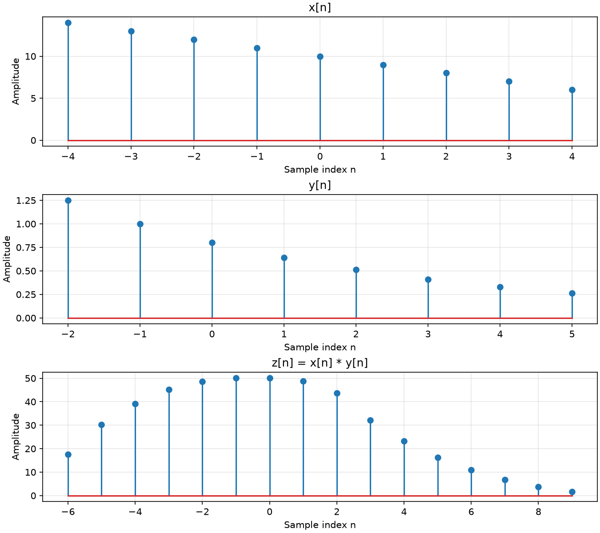
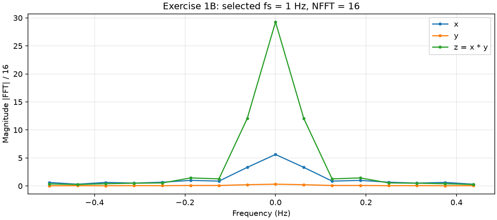
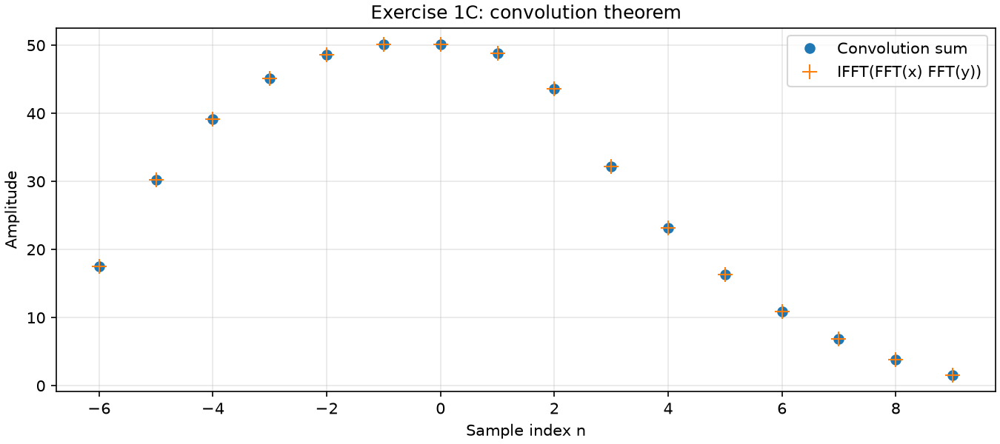
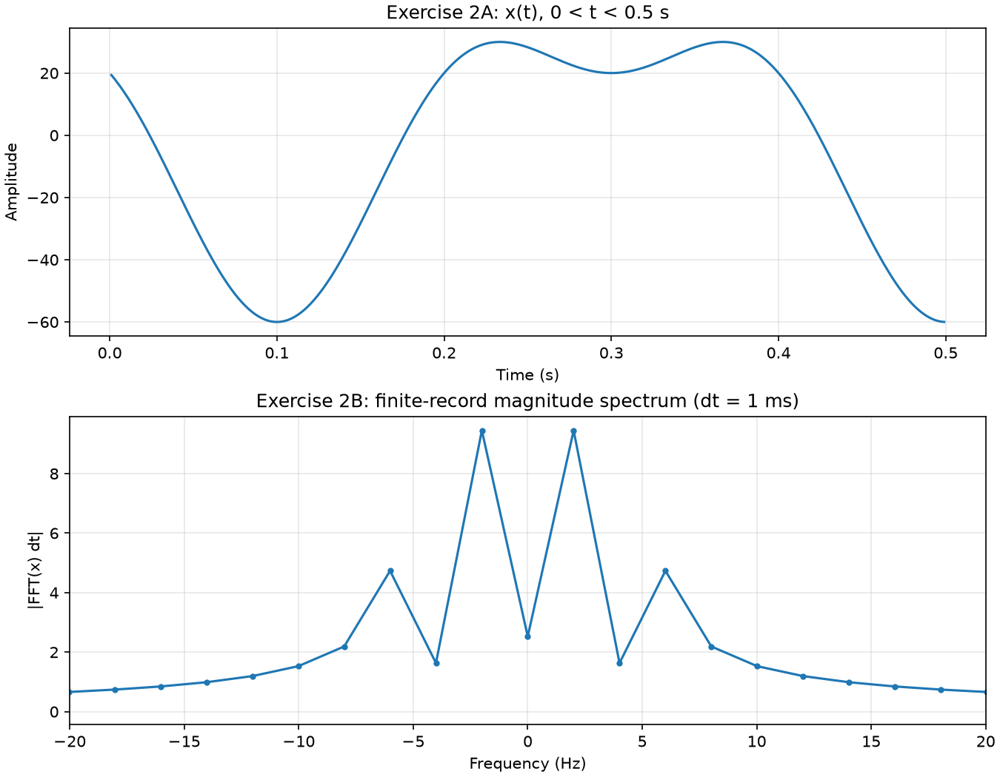
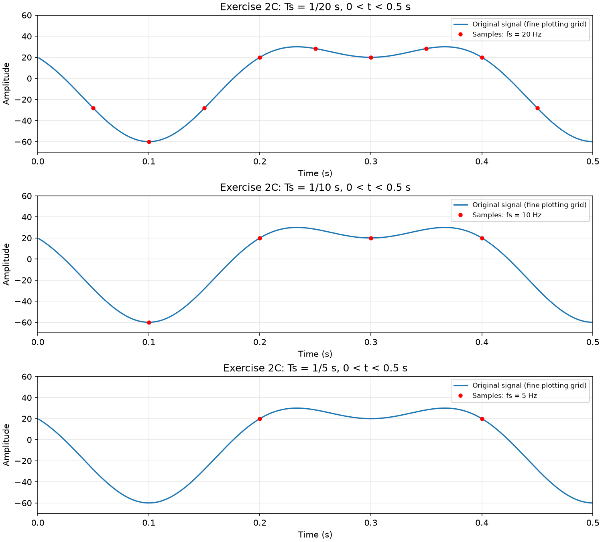
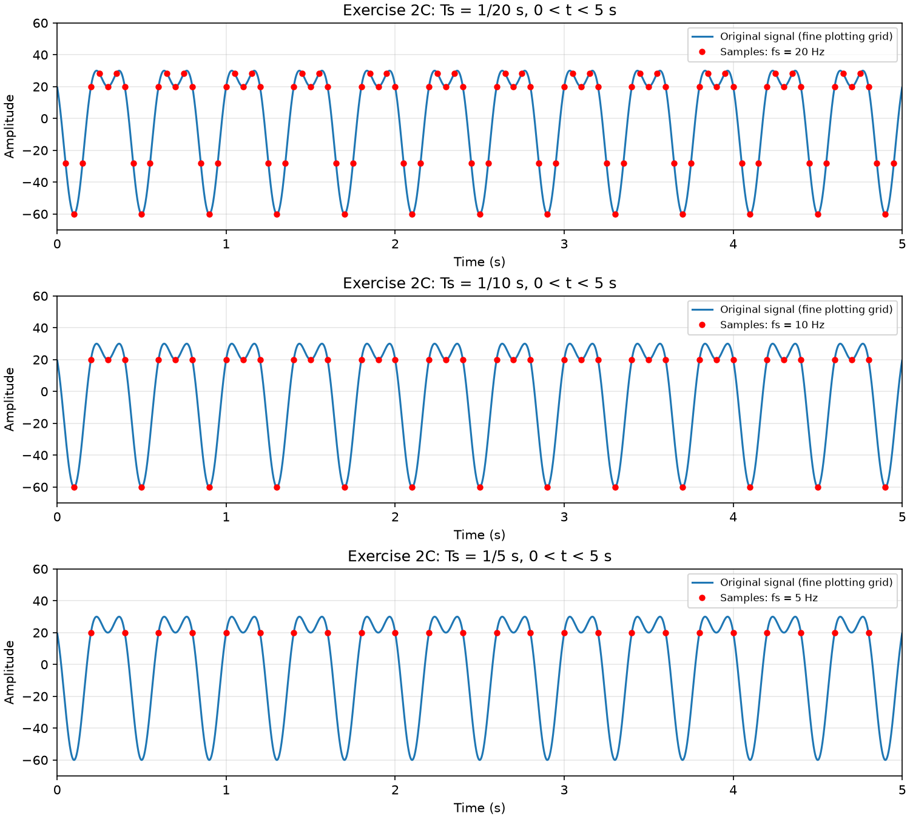
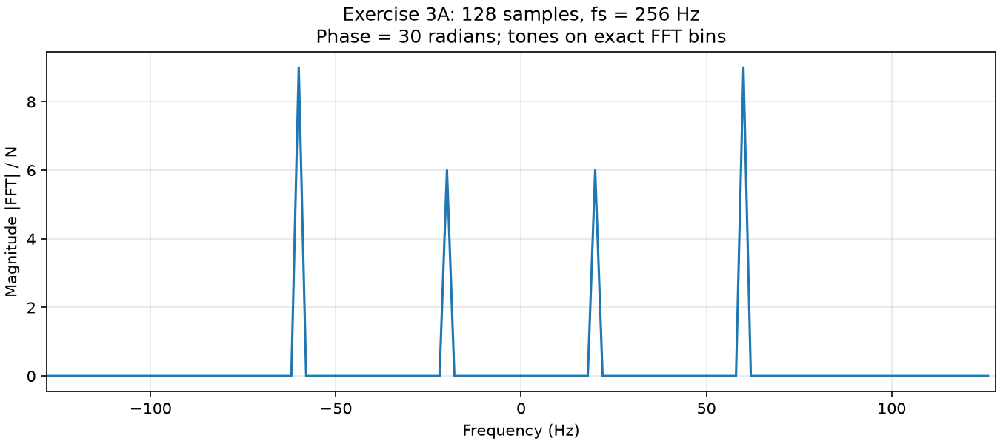
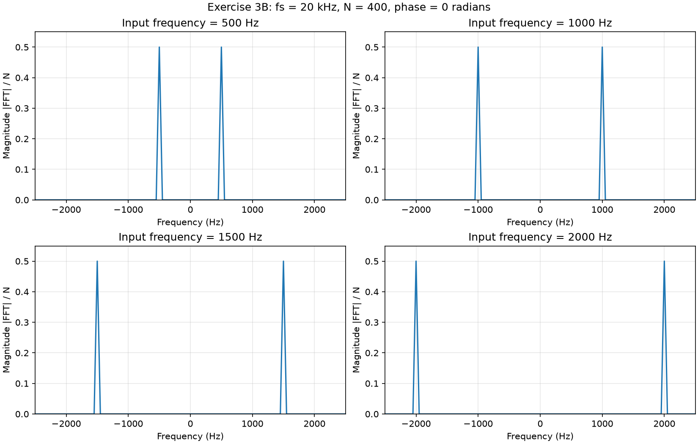
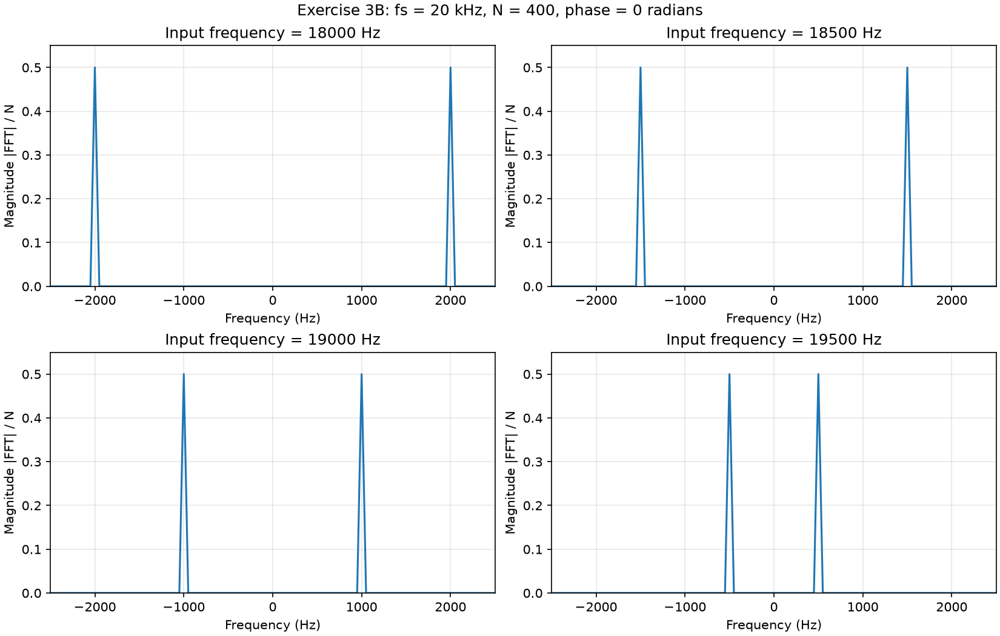

# Convolution, sampling and aliasing

**Lab 1 · Digital Signal Processing · HMMY458 / ΤΗΛ301**\
Academic year 2026–2027 · **Group number: __________**

| Full name | Student ID |
|---|---|
| ______________________________ | ______________ |
| ______________________________ | ______________ |
| ______________________________ | ______________ |

## Results at a glance

| Part | Signal or parameters | Main result |
|---|---|---|
| 1A / 1C | Input lengths 9 and 8; FFT length 16 | Convolution has 16 samples, indices −6 to 9; its FFT equals the product of the input FFTs |
| 1B | Convention Ts = 1 s, fs = 1 Hz; FFT length 16 | Common Hz axis; all three spectra peak at zero frequency |
| 2 | Components at 5 and 2.5 Hz; sampling at 20, 10 and 5 Hz | Nyquist rate 10 Hz; at 5 Hz every sample is 20 |
| 3A | 128 samples at 256 Hz | Magnitudes 6 at ±20 Hz and 9 at ±60 Hz |
| 3B | 400 samples at 20 kHz; phase 0 | High-frequency tones alias to 2000, 1500, 1000 and 500 Hz |

## Fourier-transform conventions

For N stored samples, the assignment (p. 1, equations 1-2) defines the DFT and its inverse as:

$$
X[k]=\sum_{n=0}^{N-1}x[n]e^{-j2\pi nk/N},\qquad k=0,\ldots,N-1
$$

$$
x[n]=\frac{1}{N}\sum_{k=0}^{N-1}X[k]e^{j2\pi nk/N},\qquad n=0,\ldots,N-1
$$

Here j is the imaginary unit. The FFT computes the first sum efficiently; the inverse FFT computes the second. The forward transform is unscaled, while the inverse includes `1/N`. For the discrete-sequence magnitude plots we display `|X[k]|/N`, following preparation p. 22. The convolution-theorem calculation uses the unscaled transforms. Exercise 2 uses the separately stated `dt` scaling for its continuous-time approximation.

With sampling period `Ts = 1/fs`, adjacent FFT bins are separated by `delta_f = fs/N` (preparation p. 18). On the centred frequency axis, bin q represents `f_q = q fs/N`, with `q = -floor(N/2),...,ceil(N/2)-1`. This is the ordering obtained by applying `fftshift` to both the FFT and the `fftfreq(N, d=Ts)` axis described on preparation p. 22.

## Exercise 1 · Convolution and spectra

### 1A. Sequences and convolution

The first sequence is `x[n] = 10 - n` for `-4 <= n <= 4`, with 9 samples. The second is `y[n] = 0.8^(n+1)` for `-2 <= n <= 5`, with 8 samples. Both are zero outside these ranges.

We calculate `z[n] = sum_k x[k] y[n-k]` with a loop, keeping only terms where both sequences are defined. Array positions start at zero, but the physical indices start at -4 and -2. The output therefore starts at -6 and ends at 9. Its length is `9 + 8 - 1 = 16`, as described on preparation p. 4.

The result agrees with `numpy.convolve`: the maximum absolute difference in the checked run was `8.882e-16`, within floating-point rounding. The first value is `14 * 1.25 = 17.5` and the last is `6 * 0.262144 = 1.572864`. Increasing either input length increases the full convolution length according to `Nx + Ny - 1`; the actual values depend on the products that overlap at each position.

*Figure 1. The two finite sequences and their 16-sample convolution, supported on indices −6 through 9.*

### 1B. Magnitude spectra

**Note on sampling-frequency uncertainty:** The question specifies neither a sampling frequency nor a physical sample interval, so the Hz scale is not uniquely determined. For the plot, we assume `Ts = 1 s`, or `fs = 1 Hz`. This value is a report convention, not a value supplied in the assignment. Another sampling rate would rescale the frequency axis without changing the FFT magnitudes.

Both inputs are zero-padded to 16 samples. Their FFT magnitudes and that of the convolution are plotted together, each divided by 16. The frequency spacing is `1/16 = 0.0625 Hz`; `fftfreq` and `fftshift` give bins from -0.5 to 0.4375 Hz.

The magnitudes are symmetric about zero because the sequences are real. All three peak at zero frequency, where the FFT is the sum of the samples. After division by 16, these values are 5.625 for x, 0.325089 for y and 29.25801 for z. Convolution concentrates the spectrum more strongly near zero. With the common plot normalization, the relation is `|Z|/16 = 16 (|X|/16)(|Y|/16)`.

*Figure 2. Spectra of x, y and z with a common 16-point FFT and the convention fs = 1 Hz.*

### 1C. Convolution theorem

For finite sequences, put `m = n-k` in the Fourier sum:

$$
Z(\omega)=\sum_n\sum_k x[k]y[n-k]e^{-j\omega n}
$$

$$
Z(\omega)=\left(\sum_k x[k]e^{-j\omega k}\right)\left(\sum_m y[m]e^{-j\omega m}\right)=X(\omega)Y(\omega)
$$

For the numerical check, both inputs are padded to 16 samples, the full linear-convolution length. The FFT product matches the FFT of the convolution; the maximum absolute difference was `5.684e-14`. The inverse FFT of the product also matches the convolution. Padding prevents circular overlap. The arrays start at their respective first nonzero samples, so the output is labelled from -6. Accounting for the physical origins in all three transforms gives the same identity because `-4 + (-2) = -6`.

*Figure 3. Direct convolution and the inverse FFT of the padded spectral product agree to floating-point precision.*

## Exercise 2 · Sampling and reconstruction

### 2A–B. Signal, spectrum and Nyquist rate

The specified signal is:

$$
x(t)=20\cos(10\pi t)-40\sin(5\pi t),\qquad 0<t<0.5\ \mathrm{s}
$$

Comparing angular frequencies with `2 pi f` gives components at 5 Hz and 2.5 Hz. Thus the Nyquist sampling rate is `2 * 5 = 10 Hz`.

We use a 1 ms numerical grid strictly inside `0 < t < 0.5 s` to draw the continuous signal. Following preparation pp. 23/25, the plotted finite-record spectrum is `abs(FFT(x) * dt)` with a centred Hz axis. It is an approximation for the observed time record, not the ideal infinite-duration line spectrum. The short record and frequencies falling between FFT bins spread the spectral energy. The exact component frequencies and Nyquist rate follow from the given formula, rather than from selecting the largest plotted bin. Choosing a different time origin for the same recorded samples changes the transform phase, not its magnitude.

*Figure 4. The signal over 0.5 seconds and its finite-record spectrum. The component frequencies follow from the signal formula.*

### 2C. Sampling and ideal reconstruction

Samples are at `t = n / fs`, with integer n and endpoints excluded as in the question. The plots follow preparation pp. 19-21: original curve and sampled points on the same axes.

The assignment's reconstruction model (p. 2) first forms an impulse train from the samples, then applies an ideal low-pass filter:

$$
x_s(t)=\sum_{n=-\infty}^{\infty}x[n]\delta(t-nT_s)
$$

The filter has gain `Ts` for `|Omega| <= pi/Ts` and zero gain outside that band. Its impulse response is:

$$
h_r(t)=\mathrm{sinc}(t/T_s),\qquad \mathrm{sinc}(u)=\frac{\sin(\pi u)}{\pi u},\qquad \mathrm{sinc}(0)=1
$$

Here `delta` is the Dirac impulse and `Omega` is angular frequency in radians/s. Convolving the impulse train with this filter gives the reconstruction relationship directly:

$$
x_r(t)=\sum_{n=-\infty}^{\infty}x[n]\mathrm{sinc}\!\left(\frac{t-nT_s}{T_s}\right)
$$

For a bandlimited signal whose sampled spectral copies do not overlap, ideal filtering recovers the original signal from the complete sample sequence. The brief gives the Nyquist criterion `fs >= 2 fmax`; choosing `fs > 2 fmax` avoids the boundary case discussed below. The infinite sum explains the ideal result and the limitation of a finite record.

#### Comparison over 0.5 seconds

*Figure 5. Original curve and samples at 20, 10 and 5 Hz over 0.5 seconds. At 5 Hz every sample equals 20.*

- **20 Hz (`Ts = 1/20 s`):** both components are below `fs/2 = 10 Hz`. With the ideal infinite sequence and the reconstruction theory in the brief, the signal can be recovered without aliasing. A finite set of plotted samples alone is not an exact infinite-record reconstruction.
- **10 Hz (`Ts = 1/10 s`):** the 5 Hz cosine is exactly at the Nyquist boundary. Its samples are `20 (-1)^n`; it does not vanish. The other component is `-40 sin(pi n/2)`, below that boundary. This is the limiting case illustrated for a cosine in preparation p. 20. It is not a general phase-independent guarantee: a sine at the same Nyquist boundary would have zero samples. The finite plot is not evidence of perfect reconstruction.
- **5 Hz (`Ts = 1/5 s`):** the cosine becomes `20 cos(2 pi n) = 20`, and the sine becomes `-40 sin(pi n) = 0`. Therefore every sample is 20. A DC signal of amplitude 20 has the same samples, so the original cannot be uniquely reconstructed. The 5 Hz component aliases to DC and the 2.5 Hz sine is lost at the boundary for this phase.

#### Extending the record to 5 seconds

*Figure 6. Extending the record to 5 seconds adds samples but does not change the aliasing at each sampling rate.*

Increasing the interval to `0 < t < 5 s` gives more samples and shows more repetitions, but leaves `Ts` and the aliasing conditions unchanged. At 5 Hz the samples are still all 20. A longer record can improve FFT frequency spacing and reduce some finite-record effects, but cannot recover information lost through aliasing.

## Exercise 3 · Sampling choices and aliasing

### 3A. Alias-free sampling of 128 points

The specified signal is:

$$
x(t)=12\cos(2\pi\cdot20t)-18\sin(2\pi\cdot60t+30)
$$

The signal contains 20 Hz and 60 Hz terms. The question allows choosing `fs`; we use 256 Hz, which is greater than `2 * 60 = 120 Hz`. Other rates strictly above 120 Hz also avoid aliasing for these components; choosing equality would require special care with the highest-frequency phase.

Exactly 128 samples are generated, at `n / 256` for `n = 0,...,127`. The FFT spacing is `256 / 128 = 2 Hz`. The centred, normalized magnitude spectrum has peaks of 6 at +/-20 Hz and 9 at +/-60 Hz (half the corresponding amplitudes in a two-sided spectrum).

The printed `+30` has no explicit unit. For calculation we use the convention 30 radians, as shown in the plot. The requested magnitude spectrum is unchanged if 30 degrees is used instead. The waveform samples would differ.

Here the tones fall exactly on distinct FFT bins: `20 / 2 = 10` and `60 / 2 = 30`. In the normalized DFT, the cosine gives coefficients of magnitude `12/2 = 6`. The sine gives coefficients of magnitude `18/2 = 9`; its phase appears only as a factor of unit magnitude. Since the bins do not overlap, changing the sine phase does not change the resulting magnitudes. This argument relies on the chosen sampling frequency and record length; it is not a general claim for arbitrary finite records.

The radians and degrees calculations were compared across all FFT bins: the largest magnitude difference was `3.762e-14`, below the absolute tolerance `1e-12`.

*Figure 7. With 128 samples at 256 Hz, the two-sided magnitudes are 6 at ±20 Hz and 9 at ±60 Hz.*

### 3B. Aliasing at a fixed 20 kHz sampling rate

Substituting `t = n/fs` into the given sine gives:

$$
x[n]=\sin\!\left(2\pi\frac{f_0}{20000}n+\varphi\right)
$$

For the required plots, we choose `phi = 0` radians and 400 samples because neither is prescribed in this subpart. The FFT bin spacing is `20000 / 400 = 50 Hz`, so each requested frequency falls on a bin. We use `abs(FFT) / 400` as in preparation p. 22. Each unit-amplitude sine gives two peaks of magnitude 0.5. The figures show the useful range -2500 to 2500 Hz; the remaining bins are zero to numerical precision in these records.

*Figure 8. All four low-frequency tones are below the 10 kHz Nyquist frequency; each has two magnitude peaks of 0.5.*

The four lower frequencies are below the Nyquist frequency of 10 kHz, so their peaks appear at their original positive and negative frequencies.

#### 3B. High frequencies

*Figure 9. The high-frequency tones fold to ±2000, ±1500, ±1000 and ±500 Hz at a 20 kHz sampling rate.*

| Input frequency | Signed baseband frequency | Magnitude-spectrum peaks |
|---|---|---|
| 18000 Hz | -2000 Hz | +/-2000 Hz |
| 18500 Hz | -1500 Hz | +/-1500 Hz |
| 19000 Hz | -1000 Hz | +/-1000 Hz |
| 19500 Hz | -500 Hz | +/-500 Hz |

For `f0 = fs - fa`, integer n gives `sin(2 pi f0 n/fs + phi) = sin(phi - 2 pi fa n/fs)`. With phase zero, this is the negative of the sine at `fa`; it has the same magnitude spectrum but different sample signs. These four frequencies exceed 10 kHz, so their original frequencies cannot be identified uniquely from the samples.

## Conclusions

The convolution contains 16 samples and agrees with the inverse FFT of the product of the input transforms. Increasing the observation time adds samples but does not correct aliasing. For Exercise 2, sampling at 5 Hz gives the constant value 20. In Exercise 3A, a sampling rate of 256 Hz separates the 20 and 60 Hz components. In Exercise 3B, sampling at 20 kHz maps the 18–19.5 kHz tones to 2–0.5 kHz, so their original frequencies cannot be uniquely identified from the samples.

## Sources

1. **Lab1_2026.pdf**, supplied Lab 1 assignment, pp. 1–4.
2. **Lab1-Preparation.pdf**, supplied preparation notes, pp. 4–9 and 18–25.
