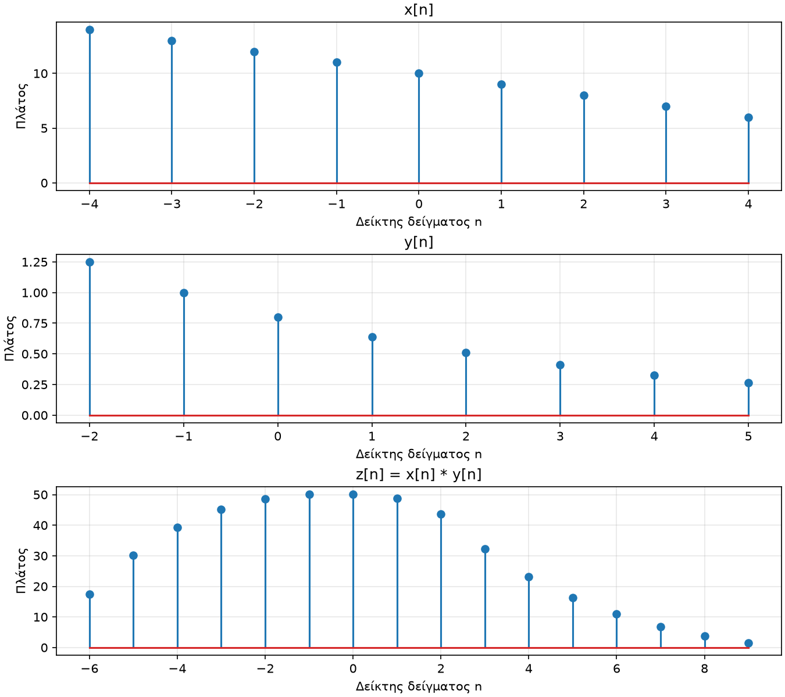
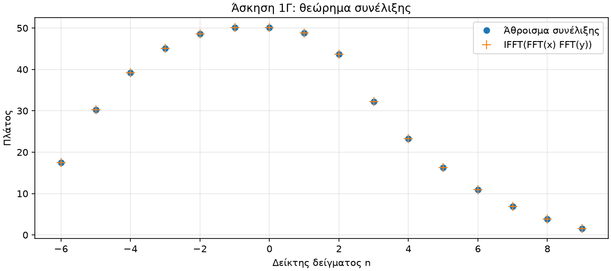
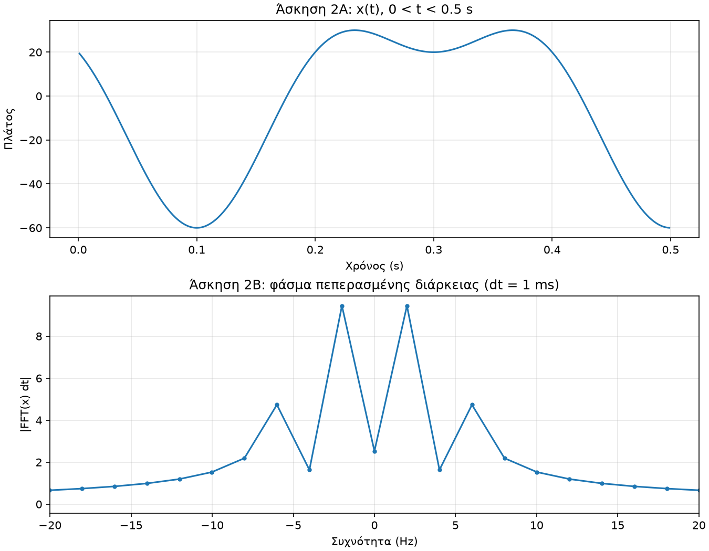
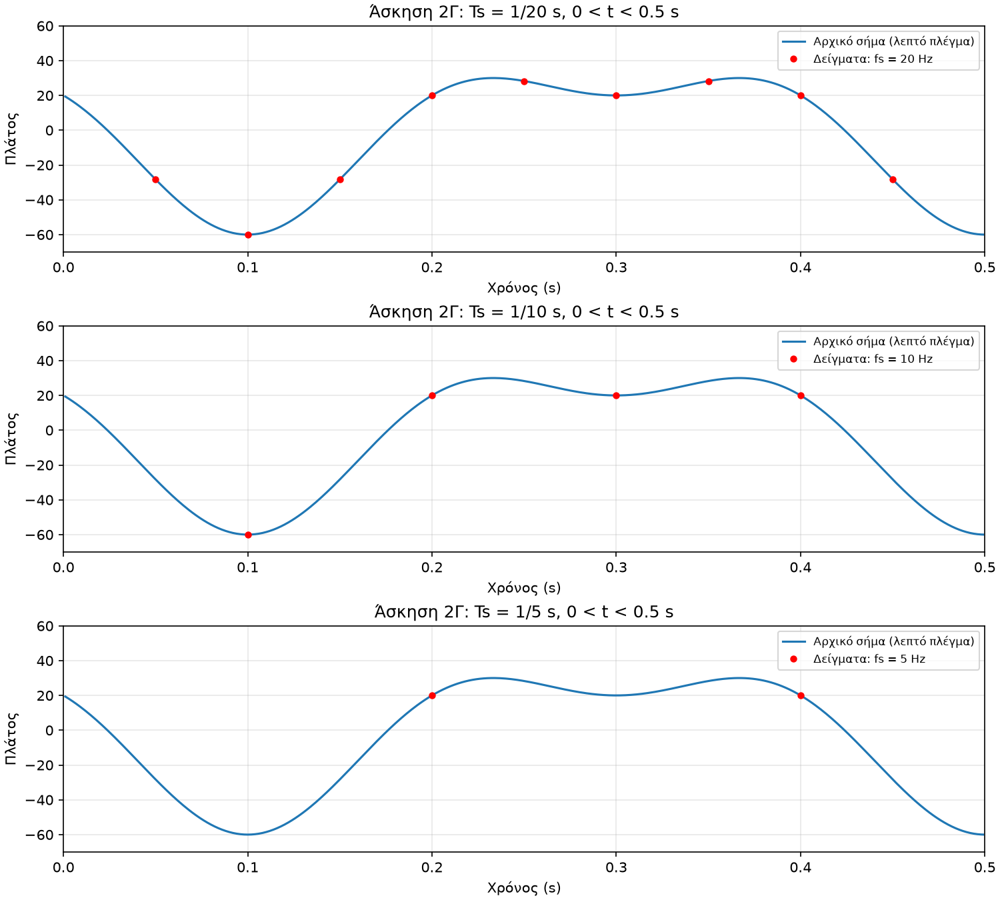
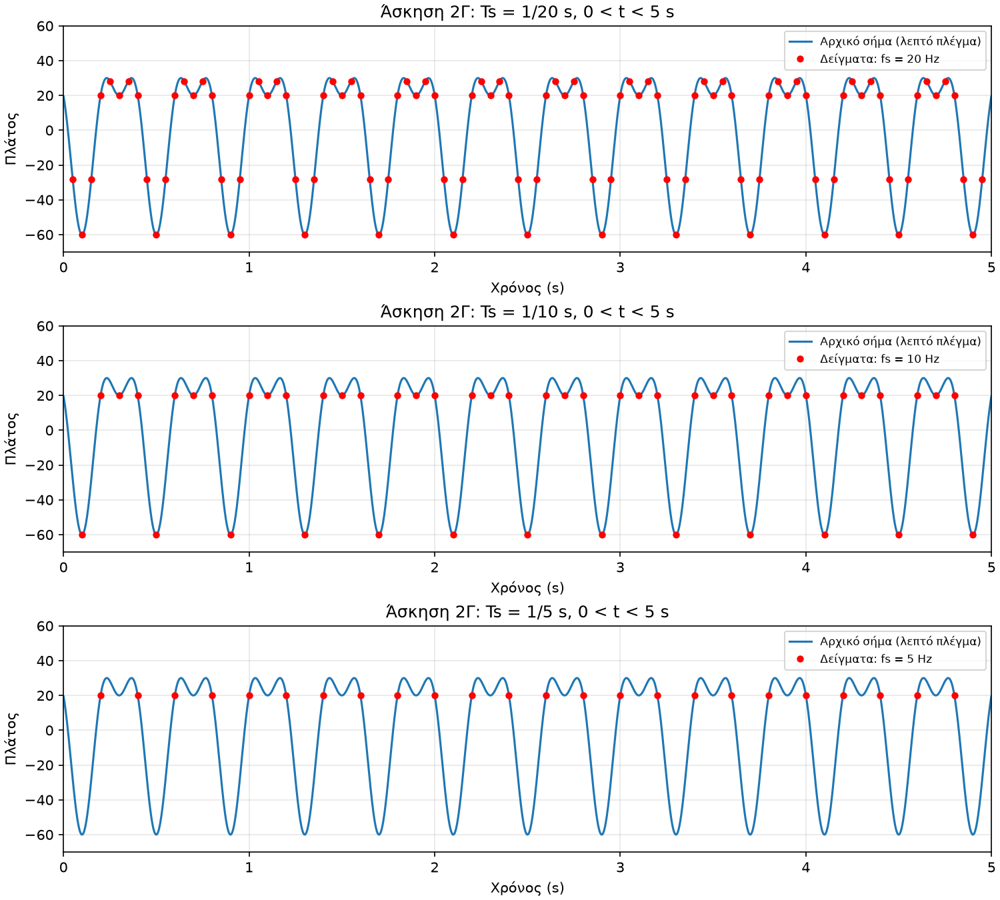
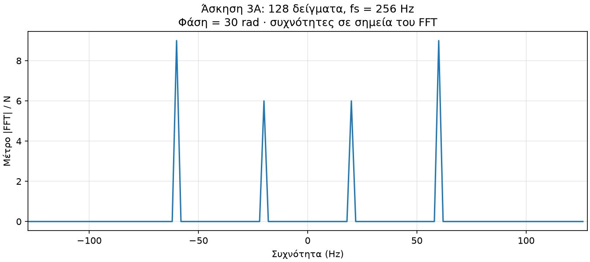
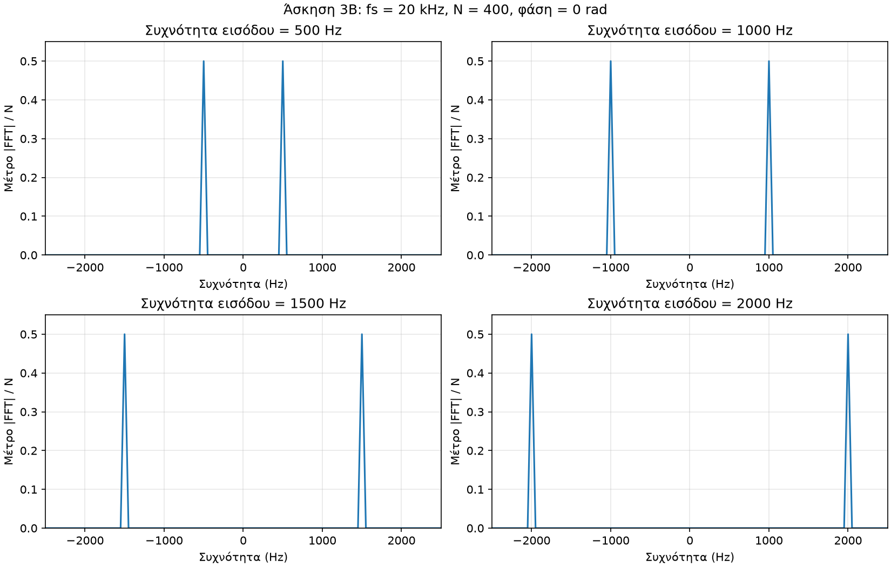
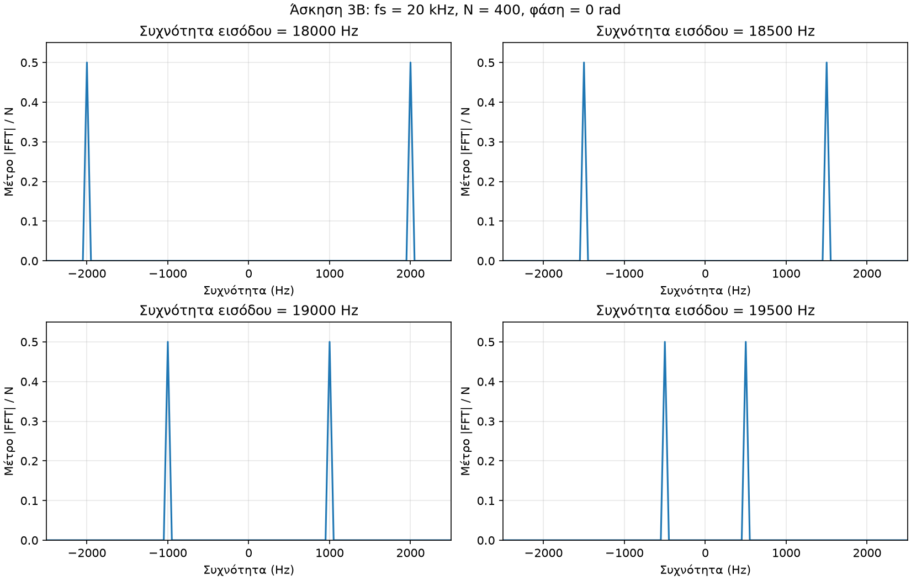

# Συνέλιξη, δειγματοληψία και επικάλυψη

**Εργαστηριακή άσκηση 1 · Ψηφιακή Επεξεργασία Σήματος · HMMY458 / ΤΗΛ301**\
Ακαδημαϊκό έτος 2026–2027 · Προσχέδιο αναφοράς · 23 Οκτωβρίου 2026

**Εκκρεμότητες:** Η συχνότητα δειγματοληψίας και το διάγραμμα σε Hz της 1Β, καθώς και τα στοιχεία ομάδας και συντακτών. Η αναφορά δεν είναι ακόμη έτοιμη για υποβολή.

## Συνοπτικά αποτελέσματα

| Ερώτημα | Δεδομένα | Αποτέλεσμα |
|---|---|---|
| 1Α / 1Γ | Μήκη εισόδων 9 και 8· FFT 16 σημείων | Συνέλιξη 16 δειγμάτων, από −6 έως 9· συμφωνία με το γινόμενο των FFT |
| 1Β | Δεν δίνεται χρονική απόσταση δειγμάτων | Εκκρεμεί ο άξονας σε Hz |
| 2 | Συνιστώσες 5 και 2.5 Hz· δειγματοληψία στα 20, 10 και 5 Hz | Ρυθμός Nyquist 10 Hz· στα 5 Hz όλα τα δείγματα είναι 20 |
| 3Α | 128 δείγματα, fs = 256 Hz | Μέτρα 6 στα ±20 Hz και 9 στα ±60 Hz |
| 3Β | 400 δείγματα, fs = 20 kHz, φάση 0 | Οι υψηλές συχνότητες εμφανίζονται στα 2000, 1500, 1000 και 500 Hz |

## Βασικές σχέσεις Fourier

Για Ν δείγματα, ο διακριτός μετασχηματισμός Fourier (DFT) και ο αντίστροφός του ορίζονται από τις σχέσεις 1–2 της εκφώνησης, σελ. 1:

$$
X[k]=\sum_{n=0}^{N-1}x[n]e^{-j2\pi nk/N},\qquad k=0,\ldots,N-1
$$

$$
x[n]=\frac{1}{N}\sum_{k=0}^{N-1}X[k]e^{j2\pi nk/N},\qquad n=0,\ldots,N-1
$$

Το j είναι η φανταστική μονάδα. Ο FFT υπολογίζει γρήγορα τον DFT. Στον ευθύ μετασχηματισμό δεν γίνεται διαίρεση με Ν· στον αντίστροφο υπάρχει ο συντελεστής `1/N`. Στα φάσματα των διακριτών ακολουθιών σχεδιάζουμε `|X[k]|/N`, όπως στις σημειώσεις προετοιμασίας, σελ. 22. Για το θεώρημα της συνέλιξης χρησιμοποιούμε τους μη κανονικοποιημένους FFT. Η διαφορετική κλιμάκωση της Άσκησης 2 εξηγείται εκεί.

Για `Ts = 1/fs`, η απόσταση των σημείων του FFT είναι `Δf = fs/N`. Στον κεντραρισμένο άξονα, το σημείο q αντιστοιχεί στη συχνότητα `f_q = q fs/N`, με `q = -floor(N/2),...,ceil(N/2)-1`. Αυτό δίνουν οι `fftfreq(N, d=Ts)` και `fftshift` όταν μετατοπίζουμε μαζί άξονα και φάσμα. Η σχέση δεν καθορίζει την άγνωστη fs της 1Β (προετοιμασία, σελ. 18 και 22).

## Άσκηση 1 · Συνέλιξη και φάσματα

### 1Α. Ακολουθίες και συνέλιξη

Η ακολουθία `x[n] = 10 - n`, για `-4 <= n <= 4`, έχει 9 δείγματα. Η `y[n] = 0.8^(n+1)`, για `-2 <= n <= 5`, έχει 8. Έξω από αυτά τα διαστήματα είναι μηδενικές.

Υπολογίζουμε τη σχέση `z[n] = sum_k x[k] y[n-k]` με βρόχο, κρατώντας τους όρους όπου ορίζονται και οι δύο ακολουθίες. Οι θέσεις των πινάκων ξεκινούν από το 0, αλλά οι δείκτες των σημάτων από −4 και −2. Άρα η συνέλιξη εκτείνεται από −6 έως 9 και έχει `9 + 8 - 1 = 16` δείγματα.

Η σύγκριση με τη `numpy.convolve` έδωσε μέγιστη απόλυτη διαφορά `8.882e-16`, στο επίπεδο της αριθμητικής στρογγυλοποίησης. Η πρώτη τιμή είναι `14 * 1.25 = 17.5` και η τελευταία `6 * 0.262144 = 1.572864`. Γενικά, το μήκος είναι `Nx + Ny - 1`· οι τιμές εξαρτώνται από τα γινόμενα που επικαλύπτονται σε κάθε θέση (προετοιμασία, σελ. 4).

*Σχήμα 1. Οι αρχικές ακολουθίες και η συνέλιξη των 16 δειγμάτων, με δείκτες από −6 έως 9.*

### 1Β. Φάσματα μέτρου · Εκκρεμεί η fs

Ο υπολογισμός FFT έχει υλοποιηθεί. Η εκφώνηση ζητά άξονα σε Hz, αλλά δεν δίνει τη χρονική απόσταση των δειγμάτων. Γι’ αυτό δεν επιλέγουμε ακόμη τιμή για την fs.

Όταν οριστεί, η `fftfreq(16, d=1/fs)` θα δώσει τον άξονα συχνοτήτων. Στο ίδιο διάγραμμα θα εμφανίζονται οι δύο είσοδοι και η συνέλιξη, με κοινό μήκος FFT 16 και κανονικοποίηση `|FFT|/16`. Η fs αλλάζει την κλίμακα του άξονα, όχι τα μέτρα των συντελεστών.

### 1Γ. Θεώρημα συνέλιξης

Θέτοντας `m = n-k` στο άθροισμα Fourier προκύπτει:

$$
Z(\omega)=\sum_n\sum_k x[k]y[n-k]e^{-j\omega n}
$$

$$
Z(\omega)=\left(\sum_k x[k]e^{-j\omega k}\right)\left(\sum_m y[m]e^{-j\omega m}\right)=X(\omega)Y(\omega)
$$

Στον αριθμητικό έλεγχο συμπληρώνουμε τις εισόδους με μηδενικά μέχρι τα 16 δείγματα. Έτσι το γινόμενο των FFT αντιστοιχεί στη γραμμική συνέλιξη, χωρίς κυκλική επικάλυψη. Η μέγιστη διαφορά από τον FFT της συνέλιξης ήταν `5.684e-14`. Ο αντίστροφος FFT του γινομένου συμφωνεί επίσης με τη συνέλιξη.

Οι πίνακες ξεκινούν από το πρώτο μη μηδενικό δείγμα κάθε σήματος. Η αρχή του αποτελέσματος είναι −6. Η ίδια ταυτότητα ισχύει και όταν ληφθούν υπόψη οι αρχικοί δείκτες, αφού `-4 + (-2) = -6`.

*Σχήμα 2. Η συνέλιξη από τον ορισμό και ο αντίστροφος FFT του γινομένου συμφωνούν εντός αριθμητικής ακρίβειας.*

## Άσκηση 2 · Δειγματοληψία και ανακατασκευή

### 2Α–Β. Σήμα, φάσμα και ρυθμός Nyquist

Το δοσμένο σήμα είναι:

$$
x(t)=20\cos(10\pi t)-40\sin(5\pi t),\qquad 0<t<0.5\ \mathrm{s}
$$

Από τη σχέση `Ω = 2πf`, οι συχνότητες είναι 5 και 2.5 Hz. Η μέγιστη είναι 5 Hz, άρα ο ρυθμός δειγματοληψίας Nyquist είναι `2 * 5 = 10 Hz`.

Για τη σχεδίαση χρησιμοποιούμε χρονικό βήμα 1 ms, με σημεία αυστηρά μέσα στο διάστημα. Το φάσμα υπολογίζεται ως `abs(FFT(x) * dt)`, με κεντραρισμένο άξονα σε Hz, σύμφωνα με την προετοιμασία, σελ. 23 και 25.

Πρόκειται για το φάσμα του πεπερασμένου χρονικού τμήματος, όχι για το ιδανικό φάσμα άπειρης διάρκειας. Το μικρό διάστημα και οι συχνότητες ανάμεσα στα σημεία του FFT απλώνουν τη φασματική ενέργεια. Γι’ αυτό βρίσκουμε τον ρυθμό Nyquist από τον τύπο του σήματος και όχι από τη μεγαλύτερη κορυφή του διαγράμματος. Η χρονική αρχή του δείγματος αναφοράς επηρεάζει τη φάση του μετασχηματισμού, όχι το μέτρο του ίδιου καταγεγραμμένου τμήματος.

*Σχήμα 3. Το σήμα στο διάστημα 0.5 s και το φάσμα του πεπερασμένου χρονικού τμήματος.*

### 2Γ. Δειγματοληψία και ιδανική ανακατασκευή

Τα δείγματα λαμβάνονται σε χρόνους `t = n/fs`, με ακέραιο n, χωρίς τα άκρα του διαστήματος. Όπως στην προετοιμασία, σελ. 19–21, σχεδιάζουμε την αρχική καμπύλη και τα δείγματα μαζί.

Η εκφώνηση, σελ. 2, περιγράφει την ανακατασκευή ως μετατροπή των δειγμάτων σε κρουστική παλμοσειρά και διέλευσή της από ιδανικό χαμηλοπερατό φίλτρο:

$$
x_s(t)=\sum_{n=-\infty}^{\infty}x[n]\delta(t-nT_s)
$$

Το φίλτρο έχει κέρδος `Ts` για `|Ω| <= π/Ts` και μηδενικό κέρδος έξω από αυτή τη ζώνη. Η κρουστική απόκρισή του είναι:

$$
h_r(t)=\mathrm{sinc}(t/T_s),\qquad \mathrm{sinc}(u)=\frac{\sin(\pi u)}{\pi u},\qquad \mathrm{sinc}(0)=1
$$

Η δ είναι η κρούση Dirac και η Ω η κυκλική συχνότητα σε rad/s. Η συνέλιξη της παλμοσειράς με την απόκριση του φίλτρου δίνει:

$$
x_r(t)=\sum_{n=-\infty}^{\infty}x[n]\mathrm{sinc}\!\left(\frac{t-nT_s}{T_s}\right)
$$

Για σήμα περιορισμένου εύρους ζώνης, χωρίς επικάλυψη των φασματικών αντιγράφων, η ιδανική ανακατασκευή ανακτά το αρχικό σήμα από ολόκληρη την ακολουθία δειγμάτων. Η εκφώνηση δίνει `fs >= 2 fmax`. Η επιλογή `fs > 2 fmax` αποφεύγει την οριακή περίπτωση της ισότητας.

Το άπειρο άθροισμα εξηγεί γιατί ένα πεπερασμένο σύνολο δειγμάτων δεν αρκεί μόνο του για να αποδείξει τέλεια ανακατασκευή. Εδώ χρησιμοποιείται ως θεωρητική σχέση· δεν προσθέτουμε αλγόριθμο παρεμβολής.

#### Σύγκριση στο διάστημα 0.5 s

*Σχήμα 4. Αρχική καμπύλη και δείγματα στα 20, 10 και 5 Hz. Στα 5 Hz όλα τα δείγματα ισούνται με 20.*

- **20 Hz (`Ts = 1/20 s`):** και οι δύο συνιστώσες είναι κάτω από το όριο `fs/2 = 10 Hz`. Με την πλήρη ακολουθία δειγμάτων και το ιδανικό φίλτρο ανακτάται το σήμα χωρίς επικάλυψη.
- **10 Hz (`Ts = 1/10 s`):** το συνημίτονο των 5 Hz βρίσκεται ακριβώς στο όριο Nyquist. Τα δείγματά του είναι `20 (-1)^n`, ενώ η άλλη συνιστώσα δίνει `-40 sin(πn/2)`. Το συνημίτονο δεν χάνεται. Η περίπτωση εξαρτάται όμως από τη φάση: ένα ημίτονο στο ίδιο όριο, με μηδενική φάση, θα έδινε μηδενικά δείγματα. Το διάγραμμα δεν αποδεικνύει τέλεια ανακατασκευή.
- **5 Hz (`Ts = 1/5 s`):** έχουμε `20 cos(2πn) = 20` και `-40 sin(πn) = 0`. Όλα τα δείγματα είναι 20, όπως και σε ένα σταθερό σήμα τιμής 20. Το αρχικό σήμα δεν προσδιορίζεται μοναδικά: η συνιστώσα των 5 Hz εμφανίζεται στη μηδενική συχνότητα και η συνιστώσα των 2.5 Hz χάνεται για αυτή τη φάση.

#### Επέκταση του διαστήματος στα 5 s

*Σχήμα 5. Η μεγαλύτερη διάρκεια δίνει περισσότερα δείγματα, αλλά δεν αλλάζει την επικάλυψη σε κάθε ρυθμό δειγματοληψίας.*

Στο `0 < t < 5 s` βλέπουμε περισσότερες περιόδους, ενώ η Ts μένει ίδια. Στα 5 Hz τα δείγματα παραμένουν όλα 20. Η μεγαλύτερη διάρκεια μειώνει την απόσταση των συχνοτήτων του FFT και μπορεί να περιορίσει ορισμένες επιδράσεις της μικρής διάρκειας. Δεν ανακτά όμως την πληροφορία που χάθηκε λόγω επικάλυψης.

## Άσκηση 3 · Επιλογή συχνότητας και επικάλυψη

### 3Α. 128 δείγματα χωρίς επικάλυψη

Το δοσμένο σήμα είναι:

$$
x(t)=12\cos(2\pi\cdot20t)-18\sin(2\pi\cdot60t+30)
$$

Οι συνιστώσες είναι 20 και 60 Hz. Επιλέγουμε `fs = 256 Hz`, αφού `256 > 2 * 60 = 120 Hz`. Κάθε συχνότητα αυστηρά μεγαλύτερη από 120 Hz αποφεύγει την επικάλυψη για αυτές τις συνιστώσες. Στην ισότητα χρειάζεται προσοχή στη φάση της συνιστώσας των 60 Hz.

Παίρνουμε ακριβώς 128 δείγματα, σε χρόνους `n/256`, για `n = 0,...,127`. Η απόσταση συχνοτήτων είναι `256/128 = 2 Hz`. Στο δίπλευρο, κανονικοποιημένο φάσμα οι κορυφές έχουν μέτρο 6 στα ±20 Hz και 9 στα ±60 Hz, δηλαδή το μισό πλάτος κάθε συνιστώσας.

Το `+30` δεν έχει δηλωμένη μονάδα στην εκφώνηση. Στον υπολογισμό το θεωρούμε 30 rad, χωρίς να το παρουσιάζουμε ως διευκρίνιση του διδάσκοντα. Αν θεωρηθεί 30°, αλλάζουν τα δείγματα, αλλά όχι το συγκεκριμένο φάσμα μέτρου.

Οι δύο συχνότητες πέφτουν ακριβώς σε διαφορετικά σημεία του FFT: `20/2 = 10` και `60/2 = 30`. Η φάση του ημιτόνου εμφανίζεται ως παράγοντας μοναδιαίου μέτρου. Εφόσον οι συντελεστές δεν επικαλύπτονται, τα μέτρα παραμένουν `12/2 = 6` και `18/2 = 9`. Αυτό ισχύει για τον συγκεκριμένο ρυθμό και αριθμό δειγμάτων, όχι για κάθε πεπερασμένη καταγραφή.

Η σύγκριση των δύο ερμηνειών σε όλα τα σημεία του FFT έδωσε μέγιστη διαφορά `3.762e-14`, μικρότερη από την απόλυτη ανοχή `1e-12`.

*Σχήμα 6. Για 128 δείγματα στα 256 Hz, οι κορυφές είναι 6 στα ±20 Hz και 9 στα ±60 Hz.*

### 3Β. Επικάλυψη με fs = 20 kHz

Με αντικατάσταση `t = n/fs` στο δοσμένο ημίτονο παίρνουμε:

$$
x[n]=\sin\!\left(2\pi\frac{f_0}{20000}n+\varphi\right)
$$

Επιλέγουμε φάση 0 rad και 400 δείγματα, αφού δεν καθορίζονται σε αυτό το ερώτημα. Η απόσταση των σημείων του FFT είναι `20000/400 = 50 Hz`, οπότε όλες οι ζητούμενες συχνότητες πέφτουν ακριβώς σε σημεία του.

Με κανονικοποίηση `abs(FFT)/400`, κάθε ημίτονο μοναδιαίου πλάτους δίνει δύο κορυφές μέτρου 0.5. Σχεδιάζουμε το χρήσιμο διάστημα −2500 έως 2500 Hz. Τα υπόλοιπα σημεία του φάσματος είναι μηδενικά εντός αριθμητικής ακρίβειας.

*Σχήμα 7. Οι τέσσερις συχνότητες είναι κάτω από το όριο Nyquist των 10 kHz. Οι κορυφές εμφανίζονται στις αρχικές θετικές και αρνητικές συχνότητες.*

*Σχήμα 8. Οι υψηλές συχνότητες εμφανίζονται στα ±2000, ±1500, ±1000 και ±500 Hz, λόγω επικάλυψης.*

| Αρχική συχνότητα | Ισοδύναμη συχνότητα με πρόσημο | Κορυφές μέτρου |
|---|---|---|
| 18000 Hz | −2000 Hz | ±2000 Hz |
| 18500 Hz | −1500 Hz | ±1500 Hz |
| 19000 Hz | −1000 Hz | ±1000 Hz |
| 19500 Hz | −500 Hz | ±500 Hz |

Για `f0 = fs - fa` και ακέραιο n ισχύει `sin(2πf0 n/fs + φ) = sin(φ - 2πfa n/fs)`. Με μηδενική φάση, το αποτέλεσμα είναι το αρνητικό του ημιτόνου στη fa: ίδιο φάσμα μέτρου, αλλά αντίθετα πρόσημα δειγμάτων. Επειδή οι αρχικές συχνότητες ξεπερνούν τα 10 kHz, δεν αναγνωρίζονται μοναδικά από τα δείγματα.

## Έλεγχοι και εκκρεμότητες

Οι 18 αριθμητικοί έλεγχοι της υλοποίησης έχουν περάσει στο περιβάλλον που καταγράφεται στο `VERIFICATION.md`. Καλύπτουν τη συνέλιξη, τους μετασχηματισμούς, τη δειγματοληψία, τη φάση και την επικάλυψη. Οι έλεγχοι δεν σημαίνουν ότι ολοκληρώθηκε η παράδοση.

Απομένουν η απόφαση για την fs της 1Β, το αντίστοιχο διάγραμμα και ο σχολιασμός του, τα συμφωνημένα στοιχεία ομάδας και συντακτών, καθώς και η δημιουργία και ο έλεγχος του ZIP. Η ασάφεια της φάσης στην 3Α δεν εμποδίζει το ολοκληρωμένο φάσμα μέτρου. Δεν έχει γίνει υποβολή μέσω αυτής της εργασίας.

## Πηγές

1. **Lab1_2026.pdf**, εκφώνηση: DFT και αντίστροφος, σελ. 1· δειγματοληψία και ανακατασκευή, σελ. 2· ερωτήματα και παραδοτέα, σελ. 3–4.
2. **Lab1-Preparation.pdf**, προετοιμασία: συνέλιξη και δείκτες, σελ. 4–9· Nyquist και δειγματοληψία, σελ. 18–21· συμβάσεις FFT και προσέγγιση συνεχούς χρόνου, σελ. 22–25.
